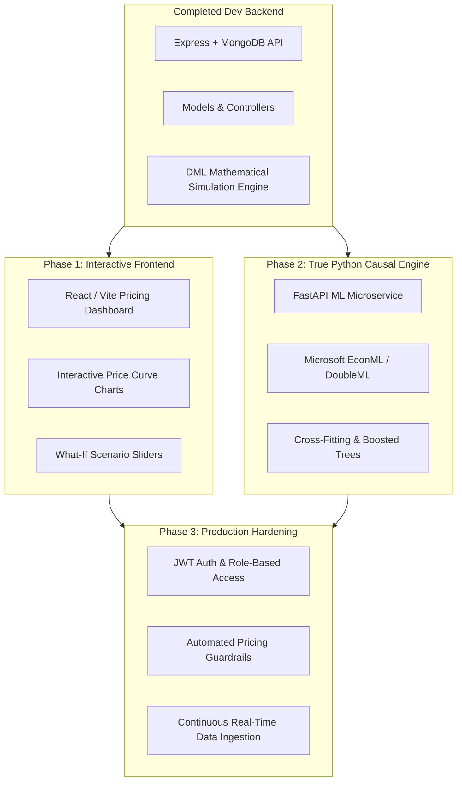

# EconoCausal: System Architecture, File-by-File Analysis & Technical Roadmap

---

## 1. Executive Summary & Project Alignment

**EconoCausal: Dynamic Pricing via Double Machine Learning** is an advanced econometric machine learning platform designed to separate **correlation from causation** in retail and e-commerce pricing decisions.

### The Core Problem: Why Traditional Machine Learning Fails at Pricing
In traditional pricing analysis, an e-commerce platform observes that coats sell more units at $150 in December than at $90 in July. A naive machine learning model (OLS regression, Random Forest, or Neural Network) will conclude that **raising prices increases demand**, leading to disastrous pricing recommendations. This failure occurs due to **confounding and price endogeneity**:
* **Confounders ($X$)**: Seasonality, holidays, competitor prices, marketing spend, and inventory scarcity simultaneously influence both the chosen price ($T$) and customer demand ($Y$).
* **Endogeneity**: Retail managers historically set higher prices when they know demand is strong.

### How EconoCausal Solves This via Double Machine Learning (DML)
EconoCausal uses the **Double Machine Learning (DML)** framework formulated by Chernozhukov et al. (2018):
1. **Stage 1 (Nuisance Function for Demand)**: A flexible model predicts demand $Y$ from confounders $X$: $\hat{Y} = g(X)$. The residual is $\tilde{Y} = Y - \hat{Y}$ (unexplained demand variations).
2. **Stage 2 (Nuisance Function for Price)**: A flexible model predicts price $T$ from confounders $X$: $\hat{T} = m(X)$. The residual is $\tilde{T} = T - \hat{T}$ (unexplained price variations / exogenous shocks).
3. **Stage 3 (Orthogonalized Causal Estimation)**: Regressing $\tilde{Y}$ on $\tilde{T}$ yields the unbiased causal treatment effect $\theta = \frac{dQ}{dP}$ and the true Price Elasticity of Demand $\epsilon$.
4. **Optimal Dynamic Pricing**: Using the microeconomic **Amoroso-Robinson condition / Lerner Index Markup Rule**:
   $$P^* = \text{Marginal Cost} \times \left( \frac{\epsilon}{1 + \epsilon} \right)$$
   EconoCausal computes the mathematically optimal price that maximizes profit without being misled by seasonal spikes.

---

## 2. File-by-File Breakdown & Alignment

Below is an exhaustive catalog of every file currently in the repository, explaining its purpose, internal mechanics, and direct role in the EconoCausal project.

```
d:/EconoCausal/
├── .gitignore
├── README.md
├── PROJECT_REPORT.md
└── backend/
    ├── .env
    ├── .env.example
    ├── .gitignore
    ├── package.json
    ├── README.md
    └── src/
        ├── server.js
        ├── config/
        │   └── db.js
        ├── models/
        │   ├── Product.js
        │   ├── SalesRecord.js
        │   └── PricingExperiment.js
        ├── services/
        │   └── dmlSimulationService.js
        ├── controllers/
        │   ├── productController.js
        │   ├── salesController.js
        │   └── pricingController.js
        ├── routes/
        │   ├── productRoutes.js
        │   ├── salesRoutes.js
        │   └── pricingRoutes.js
        └── middleware/
            └── errorHandler.js
```

---

### Root Configuration Files

#### 1. [`d:/EconoCausal/.gitignore`](file:///d:/EconoCausal/.gitignore)
* **Role**: Root Version Control Sanitization.
* **Alignment to Project**: Prevents committing sensitive credentials, system-specific files, Node `node_modules`, and Python bytecode/virtual environments (`__pycache__`, `.venv`) into Git. This ensures team members collaborating on different OS platforms maintain clean, lightweight Git repositories.

#### 2. [`d:/EconoCausal/README.md`](file:///d:/EconoCausal/README.md)
* **Role**: Repository Master Documentation.
* **Alignment to Project**: Acts as the project's front door for contributors and reviewers, outlining high-level project goals, repository layout, and quick-start instructions for launching the backend.

---

### Backend Infrastructure & Environment Files

#### 3. [`d:/EconoCausal/backend/package.json`](file:///d:/EconoCausal/backend/package.json)
* **Role**: Node.js Dependency & Script Manifest.
* **Alignment to Project**: Configures the project to use modern ECMAScript Modules (`"type": "module"`), imports foundational libraries (`express`, `mongoose`, `cors`, `helmet`, `morgan`, `dotenv`), and defines developer workflow commands (`npm run dev` with nodemon).

#### 4. [`d:/EconoCausal/backend/.env`](file:///d:/EconoCausal/backend/.env) & [`.env.example`](file:///d:/EconoCausal/backend/.env.example)
* **Role**: Environment Variable Management.
* **Alignment to Project**: Decouples application configuration from source code. Stores runtime variables such as `PORT=5000`, `NODE_ENV=development`, and `MONGO_URI=mongodb://127.0.0.1:27017/econocausal`. The `.env.example` file provides a safe template for onboarding new contributors without leaking secrets.

#### 5. [`d:/EconoCausal/backend/.gitignore`](file:///d:/EconoCausal/backend/.gitignore)
* **Role**: Backend-Specific Git Ignores.
* **Alignment to Project**: Shields the `backend` folder from tracking `node_modules` and local environment files containing confidential database credentials.

#### 6. [`d:/EconoCausal/backend/README.md`](file:///d:/EconoCausal/backend/README.md)
* **Role**: Backend Developer Manual & Endpoint Reference.
* **Alignment to Project**: Provides backend-specific setup instructions, architectural diagrams, and a quick-lookup REST endpoint cheat sheet.

---

### Core Server & Database Configuration

#### 7. [`d:/EconoCausal/backend/src/server.js`](file:///d:/EconoCausal/backend/src/server.js)
* **Role**: HTTP Server Entrypoint & Application Orchestrator.
* **Alignment to Project**:
  * Initializes the Express application.
  * Mounts security middleware (`helmet()` to harden HTTP headers, `cors()` to enable frontend communication, `morgan('dev')` for HTTP traffic inspection).
  * Boots the database connection via `connectDB()`.
  * Exposes the `/api/health` heartbeat route.
  * Aggregates and mounts the three primary route modules (`/api/products`, `/api/sales`, `/api/pricing`).
  * Attaches global 404 and central error handling middleware.

#### 8. [`d:/EconoCausal/backend/src/config/db.js`](file:///d:/EconoCausal/backend/src/config/db.js)
* **Role**: Resilient Database Connector.
* **Alignment to Project**:
  * Connects Mongoose to the MongoDB database (`mongodb://127.0.0.1:27017/econocausal`).
  * **Critical Resiliency Feature**: Disables Mongoose command buffering (`bufferCommands: false`) and introduces an `isConnectedToMongo` export. If a developer runs the project without an active MongoDB instance, the server does **not** crash; it logs a clean warning and falls back to an in-memory datastore.

---

### Data Models (`models/`)

#### 9. [`d:/EconoCausal/backend/src/models/Product.js`](file:///d:/EconoCausal/backend/src/models/Product.js)
* **Role**: Product Catalog Schema.
* **Alignment to Project**:
  * Stores commercial parameters indispensable for pricing optimization:
    * `basePrice`: Benchmark catalog price.
    * `costPrice` (Marginal Cost $MC$): Essential for calculating the profit markup $\Pi = (P - MC) \times Q$.
    * `currentPrice`: Active price displayed in store.
    * `competitorPrice`: Key market confounder variable.
    * `minPrice` & `maxPrice`: Mathematical guardrails ensuring the dynamic pricing engine never prices below cost or violates brand policy.
    * `inventory`: Stock level indicating scarcity.
    * `estimatedElasticity`: Historical price elasticity parameter ($\epsilon$).

#### 10. [`d:/EconoCausal/backend/src/models/SalesRecord.js`](file:///d:/EconoCausal/backend/src/models/SalesRecord.js)
* **Role**: Transaction & Confounder Dataset Schema.
* **Alignment to Project**:
  * Stores historical observation data necessary for Double Machine Learning estimation:
    * Outcome ($Y$): `unitsSold`, `revenue`.
    * Treatment ($T$): `price`, `discountPercentage`.
    * Confounders ($X$): `competitorPrice`, `isPromotionActive`, `inventoryLevel`, `seasonalityIndex`, `dayOfWeek`.

#### 11. [`d:/EconoCausal/backend/src/models/PricingExperiment.js`](file:///d:/EconoCausal/backend/src/models/PricingExperiment.js)
* **Role**: Causal Inference Results & Experiment Store.
* **Alignment to Project**:
  * Preserves the analytical findings of DML optimization runs:
    * `causalTreatmentEffect`: Unbiased marginal slope $\frac{dQ}{dP}$.
    * `priceElasticity`: Estimated elasticity $\epsilon$.
    * `confidenceInterval`: Lower and upper bounds at 95% statistical significance ($[\epsilon_{low}, \epsilon_{high}]$).
    * `recommendedOptimalPrice`: Profit-maximizing price $P^*$.
    * `projectedProfitLiftPercentage`: Estimated financial gain from adopting the recommended price.
    * `priceDemandCurve`: Array of coordinate points `(price, predictedDemand, predictedRevenue, predictedProfit)` used to render dynamic charts in the frontend.

---

### Business Logic & Causal Engines (`services/`)

#### 12. [`d:/EconoCausal/backend/src/services/dmlSimulationService.js`](file:///d:/EconoCausal/backend/src/services/dmlSimulationService.js)
* **Role**: Econometric DML & Dynamic Pricing Calculation Engine.
* **Alignment to Project**:
  * **Orthogonal Residualization**: Simulates the two-stage regression of Double Machine Learning by removing confounding signals (promotions, seasonality, competitor prices) from price and demand before computing the causal slope.
  * **Amoroso-Robinson Lerner Optimization**: Computes $P^* = MC \times \left(\frac{\epsilon}{1 + \epsilon}\right)$ to identify the apex of the profit curve.
  * **Price-Demand Curve Generator**: Evaluates constant-elasticity demand functions $Q(P) = Q_0 \times (P / P_0)^\epsilon$ across candidate price steps to produce discrete simulation curves.
  * **Synthetic Dataset Generator**: Produces realistic 45-day transactional sales histories with realistic demand shocks, seasonality, and competitor fluctuations for rapid development and testing.

---

### Request Controllers (`controllers/`)

#### 13. [`d:/EconoCausal/backend/src/controllers/productController.js`](file:///d:/EconoCausal/backend/src/controllers/productController.js)
* **Role**: Product Catalog Request Handlers.
* **Alignment to Project**:
  * `getProducts`: Fetches catalog for the pricing dashboard.
  * `getProductById`: Retrieves specific item parameters for individual price sensitivity analysis.
  * `createProduct`: Registers new SKUs with cost and price boundaries.
  * `updateProductPrice`: Applies the algorithm-recommended price to production.
  * `seedProducts`: One-click database seeder that inserts demo catalog items (Electronics, Audio, Beverages) into MongoDB.

#### 14. [`d:/EconoCausal/backend/src/controllers/salesController.js`](file:///d:/EconoCausal/backend/src/controllers/salesController.js)
* **Role**: Sales & Historical Ingestion Handlers.
* **Alignment to Project**:
  * `recordSale`: Ingests transactional records containing price and environmental variables.
  * `getSalesHistory`: Fetches filtered historical observations for training DML models.
  * `seedSampleSalesData`: Synthesizes 45+ days of realistic sales data for any product ID, populating the database for immediate testing.

#### 15. [`d:/EconoCausal/backend/src/controllers/pricingController.js`](file:///d:/EconoCausal/backend/src/controllers/pricingController.js)
* **Role**: Causal Pricing & Optimization Handlers.
* **Alignment to Project**:
  * `runDMLPricingAnalysis`: Pulls historical sales, feeds them through the causal DML engine, estimates elasticity and optimal markup, and saves the experiment to MongoDB.
  * `simulatePricingScenarios`: Takes user-specified scenario values (e.g. what-if elasticity changes from -1.5 to -2.2) and returns simulated demand, revenue, and profit curves.
  * `getExperiments`: Retrieves past model runs for historical auditability and strategy comparison.

---

### Routing & Middleware

#### 16. [`d:/EconoCausal/backend/src/routes/productRoutes.js`](file:///d:/EconoCausal/backend/src/routes/productRoutes.js)
* **Role**: Product Route Declarations.
* **Alignment to Project**: Exposes `GET /`, `POST /`, `POST /seed`, `GET /:id`, and `PATCH /:id/price`.

#### 17. [`d:/EconoCausal/backend/src/routes/salesRoutes.js`](file:///d:/EconoCausal/backend/src/routes/salesRoutes.js)
* **Role**: Sales Route Declarations.
* **Alignment to Project**: Exposes `GET /`, `POST /`, and `POST /seed`.

#### 18. [`d:/EconoCausal/backend/src/routes/pricingRoutes.js`](file:///d:/EconoCausal/backend/src/routes/pricingRoutes.js)
* **Role**: Pricing & DML Route Declarations.
* **Alignment to Project**: Exposes `POST /optimize`, `POST /simulate`, and `GET /experiments`.

#### 19. [`d:/EconoCausal/backend/src/middleware/errorHandler.js`](file:///d:/EconoCausal/backend/src/middleware/errorHandler.js)
* **Role**: Central Error Dispatcher.
* **Alignment to Project**: Intercepts unhandled exceptions and undefined routes (`404 Not Found`), formatting responses as clean JSON objects with sanitized stack traces in development.

---

## 3. Comprehensive API Endpoints Reference

All endpoints are hosted at `http://localhost:5000`.

### System Health
```http
GET /api/health
```
* **Response (200 OK)**:
```json
{
  "status": "online",
  "service": "EconoCausal Backend API",
  "version": "1.0.0",
  "timestamp": "2026-10-10T16:51:47.769Z",
  "environment": "development"
}
```

---

### Products API (`/api/products`)

#### 1. Retrieve All Products
```http
GET /api/products
```
* **Response (200 OK)**:
```json
{
  "success": true,
  "count": 3,
  "data": [
    {
      "_id": "6aca6d878136384cca9758f7",
      "name": "Ergonomic Mechanical Keyboard",
      "sku": "TECH-KB-001",
      "category": "Electronics",
      "basePrice": 120,
      "costPrice": 55,
      "currentPrice": 115,
      "competitorPrice": 119,
      "inventory": 340,
      "estimatedElasticity": -1.82
    }
  ]
}
```

#### 2. Seed Default Product Catalog
```http
POST /api/products/seed
```
* Populates MongoDB with default items (Keyboard, Headphones, Coffee Blend).

#### 3. Update Active Price
```http
PATCH /api/products/:id/price
Content-Type: application/json

{
  "newPrice": 99.50
}
```

---

### Sales API (`/api/sales`)

#### 1. Retrieve Sales History
```http
GET /api/sales?productId=6aca6d878136384cca9758f7
```

#### 2. Record New Sale Transaction
```http
POST /api/sales
Content-Type: application/json

{
  "productId": "6aca6d878136384cca9758f7",
  "price": 115.00,
  "unitsSold": 14,
  "discountPercentage": 5,
  "isPromotionActive": false,
  "competitorPrice": 119.00
}
```

#### 3. Seed Synthetic Historical Observations
```http
POST /api/sales/seed
Content-Type: application/json

{
  "productId": "6aca6d878136384cca9758f7",
  "basePrice": 120,
  "days": 45
}
```

---

### Pricing & Causal DML API (`/api/pricing`)

#### 1. Run Causal DML Price Optimization
```http
POST /api/pricing/optimize
Content-Type: application/json

{
  "productId": "6aca6d878136384cca9758f7",
  "title": "Q4 Dynamic Pricing Causal Optimization"
}
```
* **Response (200 OK)**:
```json
{
  "success": true,
  "message": "Causal DML analysis completed and saved",
  "data": {
    "_id": "6aca6dc08136384cca975941",
    "title": "Q4 Dynamic Pricing Causal Optimization",
    "methodology": "Double Machine Learning (DML) - Orthogonal Residualization",
    "sampleSize": 46,
    "causalTreatmentEffect": -2.3609,
    "priceElasticity": -2.833,
    "confidenceInterval": {
      "lower": -3.277,
      "upper": -2.389
    },
    "currentPrice": 115,
    "recommendedOptimalPrice": 85,
    "projectedDemandAtOptimal": 568,
    "projectedRevenueAtOptimal": 36920,
    "priceDemandCurve": [
      {
        "price": 65,
        "predictedDemand": 568,
        "predictedRevenue": 36920,
        "predictedProfit": 5680
      },
      {
        "price": 85,
        "predictedDemand": 260,
        "predictedRevenue": 22100,
        "predictedProfit": 7800
      }
    ]
  }
}
```

#### 2. Interactive Pricing What-If Simulation
```http
POST /api/pricing/simulate
Content-Type: application/json

{
  "basePrice": 150,
  "costPrice": 60,
  "currentPrice": 145,
  "elasticity": -1.9,
  "minPrice": 70,
  "maxPrice": 220,
  "steps": 15
}
```

#### 3. View Historical Optimization Experiments
```http
GET /api/pricing/experiments
```

---

## 4. What is Yet to be Done & Why it is Needed

To take EconoCausal from its current dev backend to a complete, production-grade, publication-ready platform, the following components should be developed:



### 1. Interactive React Frontend Dashboard (MERN Component)
* **What needs to be done**:
  * Build a React (or Vite + Tailwind/Modern CSS) dashboard.
  * Interactive Chart.js / Recharts visualization of the **Price-Demand Curve**, **Revenue Curve**, and **Profit Apex**.
  * Dynamic sliders for real-time what-if scenario simulations (adjusting competitor price, target elasticity, and discount percentage).
  * One-click "Apply Optimal Price" button connecting to `PATCH /api/products/:id/price`.
* **Why it is needed**:
  * Pricing analysts and business stakeholders cannot evaluate econometric models via raw terminal cURL requests. A visual dashboard provides intuitive decision support.

---

### 2. Python Causal ML Microservice (`EconML` / `DoubleML`)
* **What needs to be done**:
  * Create a lightweight Python FastAPI service (e.g. `/ml-service`).
  * Install `econml`, `doubleml`, `scikit-learn`, `lightgbm`.
  * Implement K-fold cross-fitting (Neyman-orthogonal Double Machine Learning with Random Forests and Gradient Boosting).
  * Connect Node.js `dmlSimulationService.js` to dispatch heavy training jobs to FastAPI via HTTP or Redis Queue.
* **Why it is needed**:
  * While our Node.js service implements the exact econometric equations, high-dimensional datasets with dozens of confounding covariates (weather, clickstreams, multi-competitor matrices) benefit from the cutting-edge non-parametric estimators found in Python's `EconML`.

---

### 3. User Authentication & Role-Based Access Control (RBAC)
* **What needs to be done**:
  * Add a `User` Mongoose schema with `bcryptjs` password hashing.
  * Implement JWT authentication middleware (`authMiddleware.js`).
  * Define roles: `Viewer` (can inspect charts), `PricingAnalyst` (can run DML simulations), and `Admin` (can update production prices).
* **Why it is needed**:
  * In commercial retail environments, dynamically changing product prices affects bottom-line revenues; unauthorized modifications must be strictly prevented.

---

### 4. Dynamic Pricing Guardrails & Safety Triggers
* **What needs to be done**:
  * Add velocity checks (e.g. price cannot adjust by more than $\pm 10\%$ in a 24-hour window).
  * Inventory-sensitive throttling (if inventory drops below 10 units, pause aggressive discounting to avoid stockout).
* **Why it is needed**:
  * Algorithmic pricing engines without guardrails can cause "pricing flash crashes" if external market conditions experience rapid volatility.

---

### 5. Automated Data Ingestion & Continuous Retraining
* **What needs to be done**:
  * Add CSV/Excel upload endpoints for historical e-commerce datasets (e.g. Kaggle Retail Data, Amazon/Shopify exports).
  * Scheduled cron job (e.g. weekly) to re-estimate price elasticity as consumer behavior shifts.
* **Why it is needed**:
  * Consumer price sensitivity changes across seasons and economic cycles; static elasticity estimates degrade over time.

---

## 5. Summary Table: Next Steps Priority

| Priority | Feature | Tech Stack | Estimated Scope | Benefit |
| :---: | :--- | :--- | :---: | :--- |
| **P1** | **React Frontend Dashboard** | React / Vite, Chart.js / Recharts | Moderate | Visualizes causal demand curves and brings the MERN stack to life |
| **P2** | **CSV / Dataset Import** | Multer, Fast-CSV | Small | Allows running DML on real-world transaction logs |
| **P3** | **Python ML Engine (`EconML`)** | FastAPI, EconML, LightGBM | Moderate | True non-parametric Double Machine Learning with cross-fitting |
| **P4** | **JWT Authentication & RBAC** | JWT, Bcrypt, Express Middleware | Small | Secure enterprise-ready access control |
| **P5** | **Pricing Guardrails & Auto-reprice** | Node.js Rules Engine | Small | Prevents margin erosion and volatile swings |
