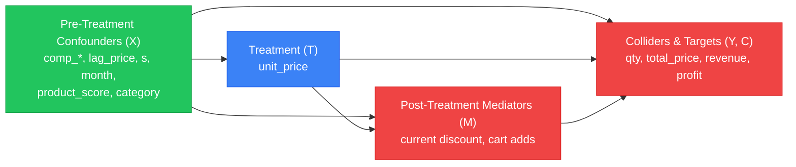

# Causal Feature Engineering & Confounder Audit Specification (Day 13)

This document provides the formal econometric justification, causal graph architecture, confounder audit, and anti-leakage framework for the **EconoCausal Dynamic Pricing Pipeline**.

---

## 1. Confounder Audit: The 13 Canonical Baseline Confounders

Under the Double Machine Learning (DML) / Neyman-orthogonal framework, confounders ($X$) must satisfy the **Conditional Ignorability / Unconfoundedness** assumption:
$$\{Y(t)\}_{t \in \mathcal{T}} \perp T \mid X$$
Confounders must simultaneously influence the merchant's pricing intervention decision ($T$) and customer purchasing volume ($Y$). Crucially, they must be strictly **pre-treatment** and exogenous to the intervention.

Below is the systematic audit of the 13 canonical confounders utilized in `DEFAULT_CONFOUNDER_COLS`:

| # | Confounder Name | Causal Role & Category | Pre-Treatment Status | Econometric & Behavioral Justification |
|---|---|---|---|---|
| 1 | `comp_1` | Market Competition (Direct) | **Strictly Pre-Treatment** | Primary competitor's price. Directly influences merchant pricing rules (competitive benchmarking) and consumer cross-price elasticity (substitution effect). |
| 2 | `comp_2` | Market Competition (Secondary) | **Strictly Pre-Treatment** | Secondary competitor's price. Controls for wider market pricing distribution and consumer alternative choice sets. |
| 3 | `comp_3` | Market Competition (Tertiary) | **Strictly Pre-Treatment** | Tertiary competitor's price. Expands competitive horizon to capture broader market shifts. |
| 4 | `fp1` | Competitor Shipping Cost | **Strictly Pre-Treatment** | Competitor 1 freight price. Directly affects competitor total landed cost to consumers. |
| 5 | `fp2` | Competitor Shipping Cost | **Strictly Pre-Treatment** | Competitor 2 freight price. Benchmarks logistical friction across rival merchants. |
| 6 | `fp3` | Competitor Shipping Cost | **Strictly Pre-Treatment** | Competitor 3 freight price. Captures delivery cost competitiveness. |
| 7 | `product_score` | Product Quality / Reputation | **Strictly Pre-Treatment** | Average customer review score (1.0 to 5.0). Establishes baseline brand equity and quality perception; high-reputation products command premium prices with lower price sensitivity. |
| 8 | `customers` | Market Size / Potential | **Strictly Pre-Treatment** | Total unique customer interactions / store traffic in the period. Proxies market volume capacity; large traffic spikes motivate promotional volume discounting. |
| 9 | `s` | Macro Seasonality Trend | **Strictly Pre-Treatment** | Sales demand seasonality index. Controls for macroeconomic seasonal surges (e.g. holidays, shopping festivals) that simultaneously trigger pricing campaigns and demand spikes. |
| 10 | `weekday` | Calendar Composition | **Strictly Pre-Treatment** | Number of business days in observation period. Controls for weekday vs. weekend business and purchasing patterns. |
| 11 | `holiday` | Calendar Holiday Surge | **Strictly Pre-Treatment** | Number of official public holidays in observation period. Controls for promotional calendar shifts and consumer leisure shopping availability. |
| 12 | `lag_price` | Historical Price Anchor | **Strictly Pre-Treatment** | Unit price in the preceding period ($P_{t-1}$). Captures price stickiness, merchant margin targets, and consumer reference price anchoring (Kahneman & Tversky prospect theory). |
| 13 | `freight_price` | Store Logistics / Shipping | **Strictly Pre-Treatment** | Merchant shipping fee charged for the item. Dictates landed price to the customer and internal cost margins, directly constraining price adjustments. |

---

## 2. Domain-Justified Engineered Features

To enrich causal estimation, capture non-linear market interactions, and increase nuisance model predictive power ($R^2_Y$ and $R^2_T$), `engineer_causal_features()` derives new pre-treatment features supported by `retail_price.csv`:

### A. Pre-Treatment Competitor-Price Gaps & Dispersion
- **`comp_price_diff_1 = lag_price - comp_1`**: Price gap between our prior-period anchor price and competitor 1. Positive values indicate our prior price was at a premium; negative values indicate a discount.
- **`comp_price_ratio_1 = comp_1 / lag_price`**: Relative price ratio comparing competitor 1 to our prior price anchor.
- **`comp_price_min = min(comp_1, comp_2, comp_3)`**: The lowest price available among market competitors.
- **`comp_price_max = max(comp_1, comp_2, comp_3)`**: The highest price among competitors.
- **`comp_price_mean = mean(comp_1, comp_2, comp_3)`**: Average market competitor price.
- **`comp_price_spread = comp_max - comp_min`**: Competitor price dispersion. High dispersion indicates market pricing uncertainty; low dispersion indicates price convergence.
- **`lag_price_diff_comp_min = lag_price - comp_price_min`**: Distance between our reference price and the most aggressive market competitor.
- **`comp_freight_diff_1 = freight_price - fp1`**: Difference in shipping fees relative to competitor 1.
- **`comp_score_diff_1 = product_score - ps1`**: Difference in customer rating vs competitor 1.

> [!IMPORTANT]
> **Strict Pre-Treatment Guarantee**: Competitor price differentials must NEVER use current `unit_price`. Using current price creates circular treatment leakage ($T$ in $X$), inflating standard errors and biasing the causal elasticity estimate.

### B. Seasonality & Cyclical Dynamics
- **`sin_month = sin(2 * pi * month / 12)`**: Periodic cyclical sine transformation of calendar month (1 to 12).
- **`cos_month = cos(2 * pi * month / 12)`**: Periodic cyclical cosine transformation. Ensures smooth continuity where December ($12$) and January ($1$) are mathematically adjacent.
- **`is_q4`**: Binary indicator for Q4 holiday shopping season (October, November, December).
- **`weekend_ratio = weekend / (weekday + weekend)`**: Proportion of weekend days in the observation month.
- **`holiday_ratio = holiday / (weekday + weekend)`**: Frequency of holidays in the period.

### C. Pre-Treatment Discount History
- **`historical_discount_rate`**: Measures discount depth at period $t-1$ relative to pre-treatment reference anchor ($P_{\text{ref}}$):
  $$\text{historical\_discount\_rate} = \frac{P_{\text{ref}} - \text{lag\_price}}{P_{\text{ref}}}$$
  where $P_{\text{ref}}$ is derived from product maximum historical lag price or market competitor average.
- **`is_lag_discounted`**: Binary indicator ($\text{historical\_discount\_rate} > 0.05$) signaling whether the product entered the period already on a promotional discount.
- **`lag_price_ratio_comp_mean`**: Ratio of previous price to market average price, characterizing initial price positioning.

### D. Product Category & Listing Characteristics
- **`product_category_name`**: Categorical moderator capturing baseline demand, elasticity tiers, and margin structures across 9 retail departments.
- **`customers_per_day = customers / total_days`**: Daily customer traffic density.
- **`product_weight_g`, `volume`, `product_photos_qty`, `product_description_lenght`**: Physical and merchandising quality attributes.

---

## 3. Causal Separation & Anti-Leakage Taxonomy

Observational variables are strictly partitioned into four mutually exclusive causal classes:

### 1. Pre-Treatment Confounders ($X$) — CONDITION ON
- Determined prior to price setting.
- Common causes of both pricing strategy and consumer purchasing volume.
- Conditioning isolates the exogenous variation in price required for causal identification.

### 2. Treatment Variable ($T$) — PREVENT LEAKAGE
- Selling unit price (`unit_price`, `price`, `log_unit_price`).
- **LEAKAGE RISK**: If $T$ or any derived transformation of $T$ enters $X$, the first-stage residualization $\tilde{T} = T - \hat{m}(X)$ collapses to $\tilde{T} \approx 0$, destroying identification.
- Guarded by `CausalLeakageError`.

### 3. Post-Treatment Mediators ($M$) — DO NOT CONDITION
- Variables lying on the causal chain between price and demand: $T \to M \to Y$.
- Examples: Current promotional discount $(P_{\text{ref}} - P) / P_{\text{ref}}$, price-comparison clicks, customer cart additions.
- Conditioning on mediators blocks the causal effect of price on demand (Post-Treatment Bias, Rosenbaum 1984).

### 4. Colliders ($C$) and Targets ($Y$) — DO NOT CONDITION
- Variables caused by both treatment and demand: $T \to C \leftarrow Y$.
- Examples: `total_price` ($P \times Q$), `revenue`, `profit` ($P \times Q - C \times Q$).
- Conditioning on colliders creates spurious non-causal associations between treatment and unobserved disturbances (Berkson's Paradox / M-bias).

---

## 4. Missing-Data Handling Policy

To ensure zero data leakage across evaluation folds and production inference:

1. **Training-Fold Imputation**:
   - Numerical missing values: Imputed via `SimpleImputer(strategy="median")`.
   - Categorical missing values: Imputed via `SimpleImputer(strategy="most_frequent")`.
   - Imputers are fitted **strictly on training folds** (`X_train`). Test sets and real-time production inference payloads are transformed using the frozen training statistics.
2. **Anti-Leakage Verification**:
   - `test_strict_anti_leakage_imputation_statistics` verifies that injecting extreme values or NaNs in the test set never alters the imputation statistics.
   - All transformed output matrices are guaranteed to contain 0 NaN values.

---

## 5. Categorical Encoding & Schema Consistency

1. **Categorical Handling**:
   - Categorical columns (`product_category_name`) are encoded using `OneHotEncoder(sparse_output=False, handle_unknown="ignore")`.
   - Unseen categories at inference time are safely assigned an all-zero vector, preventing pipeline crashes.
2. **Schema Consistency**:
   - Column order: Transformed output columns always follow `feature_names_out_` deterministically, regardless of input column order.
   - Extra columns: Unexpected extra columns in test/inference payloads are discarded without error.
   - Missing columns: When `allow_missing_cols=True`, missing expected columns are filled with learned training medians.
   - DataFrame index: Output matrices strictly preserve the original row indices.

---

## 6. Verification & Test Suite Summary

The causal feature engineering and leakage suite is verified across **35 automated unit and integration tests**:
- `tests/test_preprocessing.py`: 15 passed (100% pass rate)
- `tests/test_leakage.py`: 20 passed (100% pass rate)
- End-to-end integration verified with full DML + CATE pipeline and refutations (`tests/test_pipeline.py`, `tests/test_cate.py`, `tests/test_optimizer.py`).
