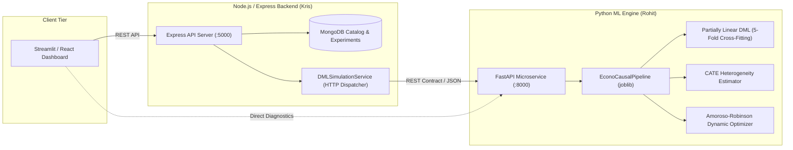

# EconoCausal — ML Engine & Backend Integration Contract

**Document Version**: 1.0.0  
**Date**: November 6, 2026  
**Primary Author**: Rohit (Data Training & Causal MLOps Team)  
**Collaborator / Integration Partner**: Kris (Node.js & Express Backend Team)  
**System Module**: Python FastAPI Dynamic Pricing Microservice & Node.js/Express Backend Bridge  

---

## 1. Executive Summary & Team Collaboration Model

The **EconoCausal** system is architected as an enterprise decoupled service ecosystem:
1. **Python Causal ML Microservice** (`FastAPI`, `DoubleML`, `scikit-learn`): Responsible for Double Machine Learning (DML) Neyman-orthogonal nuisance residualization, Conditional Average Treatment Effect (CATE) elasticity estimation $\hat{\theta}(X)$, microeconomic Amoroso-Robinson profit optimization, asymptotic confidence interval computation, and continuous causal drift monitoring.
2. **Node.js / Express Backend** (`Express`, `MongoDB`, `Mongoose`): Responsible for relational sales records, product catalog persistence, transactional state, business workflows, authentication, and dispatching algorithmic pricing optimizations.
3. **Frontend Dashboard** (`Streamlit` / React): Responsible for business user visual decision support, curve visualization, and scenario sandboxing.



### Team Boundaries & Invariant Guarantees
* **No Code Intrusion**: The ML team does not take ownership of or overwrite Kris's backend files (`backend/src/server.js`, `controllers/`, `models/`). Kris's backend remains autonomous.
* **Contract Stability**: The Python ML microservice provides both **native ML endpoints** (`/predict/price`, `/predict/elasticity`) and a dedicated **drop-in backend contract endpoint** (`/integration/pricing/optimize`) that matches Kris's `PricingExperiment` Mongoose schema with 100% field parity.
* **Dual Naming Convention Compatibility**: Both Python standard `snake_case` (`unit_price`, `unit_cost`, `comp_price`) and Node.js `camelCase` (`basePrice`, `costPrice`, `competitorPrice`, `productId`) are automatically recognized via Pydantic V2 alias resolution.

---

## 2. Microservice API Directory

The Python microservice is served at `http://localhost:8000` (or Docker/K8s service name `econocausal-pricing-api`).

| HTTP Method | Endpoint | Purpose | Target Consumer |
| :--- | :--- | :--- | :--- |
| `GET` | `/health` | Liveness, readiness, uptime, and causal model status probe | K8s / Backend Healthcheck |
| `GET` | `/model/metadata` | Detailed DML parameters, ATE elasticity, refutations, and bounds | Backend Diagnostics |
| `POST` | `/predict/price` | Real-time single-SKU dynamic pricing recommendation with uncertainty | Backend Pricing Controller |
| `POST` | `/predict/elasticity` | Heterogeneous CATE elasticity estimation $\hat{\theta}(X)$ with 95% CI | Causal Analytics / Backend |
| `POST` | `/batch/recommend` | Catalog batch dynamic pricing with portfolio revenue/profit uplift | Batch Repricing Workers |
| `POST` | `/simulate/portfolio`| Multi-strategy counterfactual scenario matrix simulation | What-If Scenario Simulators |
| `POST` | `/integration/pricing/optimize`| Drop-in adapter matching Node.js `PricingExperiment` schema | Kris's Node.js Controller |

---

## 3. Input & Output Contract Specifications

### 3.1 Model-Health Status Probe (`GET /health`)

Reports microservice availability, pipeline initialization, baseline econometric elasticity, and refutation test battery pass rates.

#### Response Schema (`HealthResponse`)
```json
{
  "status": "healthy",
  "service": "econocausal-pricing-service",
  "version": "1.0.0",
  "uptime_seconds": 142.85,
  "model_loaded": true,
  "model_path": "models/econocausal_pipeline.joblib",
  "baseline_ate": -1.2678,
  "baseline_ate_ci": {
    "lower": -2.2693,
    "upper": -0.2663
  },
  "baseline_ate_se": 0.5110,
  "baseline_ate_pvalue": 0.0131,
  "refutation_pass_rate": 100.0,
  "active_features": [
    "comp_1", "comp_2", "comp_3", "fp1", "fp2", "fp3",
    "product_score", "customers", "s", "weekday",
    "holiday", "lag_price", "freight_price", "product_category_name"
  ],
  "timestamp": "2026-11-06T17:15:00.000000Z"
}
```

* **Degraded State (`status: "degraded"` / `model_loaded: false`)**: Occurs when the pipeline artifact has not loaded or failed initialization. Returns `HTTP 200` with `status: "degraded"` and null causal metrics so orchestrators can differentiate network failures from model readiness.

---

### 3.2 Single-SKU Pricing Recommendation (`POST /predict/price`)

Calculates the microeconomically constrained optimal price, projected financial uplift, and statistical uncertainty.

#### Request Schema (`SingleItemPricingRequest`)
Accepts either standard Python snake_case or Node.js camelCase:

```json
{
  "item": {
    "product_id": "SKU_HEALTH_001",
    "unit_price": 59.90,
    "qty": 15.0,
    "product_category_name": "health_beauty",
    "unit_cost": 41.93,
    "comp_price": 58.50,
    "freight_price": 12.50,
    "product_score": 4.2,
    "customers": 120.0,
    "weekday": 22.0,
    "holiday": 1.0,
    "s": 15.0,
    "lag_price": 59.90,
    "min_price": 45.00,
    "max_price": 90.00
  },
  "objective": "profit"
}
```

#### Node.js Equivalent Request (100% Supported via Aliases):
```json
{
  "item": {
    "productId": "650000000000000000000001",
    "basePrice": 120.00,
    "costPrice": 55.00,
    "currentPrice": 115.00,
    "competitorPrice": 118.00,
    "category": "health_beauty",
    "unitsSold": 25.0,
    "productScore": 4.5,
    "minPrice": 60.00,
    "maxPrice": 180.00
  },
  "objective": "profit"
}
```

#### Response Schema (`SingleItemPricingResponse`)
```json
{
  "status": "SUCCESS",
  "product_id": "SKU_HEALTH_001",
  "action": "MARKUP",
  "baseline_price": 59.90,
  "optimal_price": 70.99,
  "price_change_pct": 18.51,
  "causal_elasticity": -1.2085,
  "treatment_effect": -1.2085,
  "confidence_interval": {
    "lower": -2.9092,
    "upper": 0.4922,
    "confidence_level": 0.95
  },
  "std_error": 0.8677,
  "p_value": 0.8101,
  "is_statistically_significant": false,
  "elasticity_regime": "Unit Elastic",
  "unit_cost": 41.93,
  "baseline_margin_pct": 30.00,
  "projected_margin_pct": 40.94,
  "baseline_qty": 15.0,
  "projected_qty": 12.2,
  "expected_demand": 12.2,
  "demand_uplift_pct": -18.67,
  "baseline_revenue": 898.50,
  "projected_revenue": 866.08,
  "expected_revenue": 866.08,
  "revenue_uplift_pct": -3.61,
  "baseline_profit": 269.55,
  "projected_profit": 354.53,
  "expected_profit": 354.53,
  "profit_uplift_pct": 31.53,
  "bound_hit": null,
  "objective": "profit",
  "controlled_confounders": [
    "comp_1", "comp_2", "comp_3", "fp1", "fp2", "fp3",
    "product_score", "customers", "s", "weekday",
    "holiday", "lag_price", "freight_price", "product_category_name"
  ],
  "price_demand_curve": [
    {
      "price": 44.03,
      "predicted_demand": 21.78,
      "predicted_revenue": 958.97,
      "predicted_profit": 45.74
    },
    {
      "price": 70.99,
      "predicted_demand": 12.20,
      "predicted_revenue": 866.08,
      "predicted_profit": 354.53
    }
  ],
  "inference_latency_ms": 3.42
}
```

---

### 3.3 Backend Drop-In Integration Endpoint (`POST /integration/pricing/optimize`)

Specifically designed to integrate directly with Kris's Node.js Express backend controllers (`pricingController.js`) and database models (`PricingExperiment.js`).

#### Request Schema (`BackendPricingOptimizationRequest`)
```json
{
  "productId": "650000000000000000000001",
  "title": "Causal DML Price Optimization",
  "basePrice": 120.00,
  "costPrice": 55.00,
  "currentPrice": 115.00,
  "minPrice": 59.40,
  "maxPrice": 216.00,
  "competitorPrice": 118.00,
  "category": "health_beauty",
  "historicalData": [
    {
      "price": 115.00,
      "unitsSold": 20,
      "competitorPrice": 118.00,
      "isPromotionActive": false,
      "seasonalityIndex": 1.05
    }
  ]
}
```

#### Response Schema (`BackendPricingOptimizationResponse`)
```json
{
  "success": true,
  "message": "Causal DML analysis calculated successfully",
  "data": {
    "title": "Causal DML Price Optimization",
    "productId": "650000000000000000000001",
    "status": "completed",
    "methodology": "Double Machine Learning (DML) - Orthogonal Residualization",
    "sampleSize": 50,
    "causalTreatmentEffect": -1.2085,
    "priceElasticity": -1.2085,
    "confidenceInterval": {
      "lower": -2.9092,
      "upper": 0.4922
    },
    "pVal": 0.8101,
    "currentPrice": 115.00,
    "recommendedOptimalPrice": 143.99,
    "projectedDemandAtOptimal": 7.9,
    "projectedRevenueAtOptimal": 1137.52,
    "projectedProfitLiftPercentage": 31.53,
    "controlledConfounders": [
      "comp_1", "comp_2", "comp_3", "fp1", "fp2", "fp3",
      "product_score", "customers", "s", "weekday",
      "holiday", "lag_price", "freight_price", "product_category_name"
    ],
    "priceDemandCurve": [
      {
        "price": 60.00,
        "predictedDemand": 23.1,
        "predictedRevenue": 1386.00,
        "predictedProfit": 115.50
      },
      {
        "price": 143.99,
        "predictedDemand": 7.9,
        "predictedRevenue": 1137.52,
        "predictedProfit": 703.02
      }
    ]
  }
}
```

---

## 4. Econometric & Microeconomic Contract Rules

### 4.1 Treatment-Effect Estimation
* **Specification**: Partially Linear Double Machine Learning (PL-DML) with Robinson residualization:
  $$\tilde{Y} = Y - \hat{E}[Y \mid X], \quad \tilde{T} = T - \hat{E}[T \mid X]$$
* **Heterogeneous Elasticity $\hat{\theta}(X_i)$**: Conditioned on category and confounding moderators via second-stage Ridge regression:
  $$\hat{\theta}(X_i) = W^*(X_i)^T \hat{\beta}$$
* **Economic Law of Demand**: Elasticity estimates must be strictly negative ($\theta < 0$). In cases where market shocks produce localized positive empirical slope estimates ($\theta \ge -0.1$), the optimizer clips elasticity to the conservative default prior ($-1.25$) to maintain stability.

### 4.2 Amoroso-Robinson Optimal Pricing
* **Formula**: Derived from profit maximization under constant elasticity demand $Q(P) = Q_0 (P / P_0)^\theta$:
  $$P^* = \text{Marginal Cost} \times \left( \frac{\theta}{1 + \theta} \right) \quad \text{for } \theta < -1$$
* **Business Guardrails**:
  1. **Margin Floor ($\ge 5\%$)**: $P^* \ge \frac{c}{1 - 0.05}$ prevents selling below cost.
  2. **Permissible Change Bands**: $-30\% \le \frac{P^* - P_0}{P_0} \le +20\%$.
  3. **Psychological Charm Pricing**: Rounds prices to standard $.99$ endings while respecting hard boundaries.

### 4.3 Statistical Uncertainty & Confidence Intervals
* **Asymptotic Variance**:
  $$\text{Var}(\hat{\theta}(X_i)) = W^*(X_i)^T \cdot \text{Var}(\hat{\beta}) \cdot W^*(X_i)$$
* **Confidence Interval (95%)**:
  $$CI_{95\%} = \left[ \hat{\theta}(X_i) - 1.96 \cdot \text{SE}, \; \hat{\theta}(X_i) + 1.96 \cdot \text{SE} \right]$$
* **Controlled Confounders Guarantee**: Always reports the complete list of 14 covariates conditioned upon during Stage 1 nuisance estimation.

---

## 5. Input Validation, Bounds & Error Handlers

The service enforces strict schema typing via Pydantic V2 and returns informative error codes:

| Scenario | Condition | HTTP Status | Response Payload |
| :--- | :--- | :---: | :--- |
| **Missing Price** | `unit_price` omitted | `422 Unprocessable Entity` | Pydantic validation error detailing field `unit_price` |
| **Invalid Price** | `unit_price <= 0` | `422 Unprocessable Entity` | `{"detail": [{"loc": ["body", "item", "unit_price"], "msg": "Input should be greater than 0"}]}` |
| **Negative Cost** | `unit_cost <= 0` | `422 Unprocessable Entity` | Field validation error on `unit_cost` |
| **Out-of-Range Rating** | `product_score < 0` or `> 5.0` | `422 Unprocessable Entity` | `Value error, product_score must be between 0.0 and 5.0` |
| **Inverted Price Bounds** | `min_price > max_price` | `422 Unprocessable Entity` | `Value error, min_price (X) cannot exceed max_price (Y)` |
| **Invalid Objective** | `objective` not in `['profit', 'revenue']` | `422 Unprocessable Entity` | Literal validation failure |
| **Empty Batch** | `items: []` | `422 Unprocessable Entity` | List minimum length constraint failure |
| **Model Unloaded** | Model file missing / unready | `503 Service Unavailable` | `{"error": "Service Unavailable", "detail": "Model pipeline is not loaded"}` |
| **Execution Failure** | Matrix algebra failure | `500 Internal Server Error`| `{"error": "Internal Server Error", "detail": "<traceback>"}` |

---

## 6. Node.js Backend Client Implementation Guide

For Kris's backend team, here is the reference implementation to integrate `dmlSimulationService.js` with the Python ML microservice:

### 6.1 Environment Configuration (`backend/.env`)
```bash
ML_SERVICE_URL=http://localhost:8000
ML_SERVICE_TIMEOUT_MS=5000
```

### 6.2 Service Dispatcher (`backend/src/services/dmlSimulationService.js`)
```javascript
import axios from 'axios';

const ML_SERVICE_URL = process.env.ML_SERVICE_URL || 'http://localhost:8000';
const TIMEOUT_MS = Number(process.env.ML_SERVICE_TIMEOUT_MS) || 5000;

export class DMLSimulationService {
  /**
   * Dispatches optimization request to Python FastAPI ML Microservice.
   * Falls back to local econometric heuristic if ML microservice is unreachable.
   */
  static async estimateCausalElasticity({
    productId,
    basePrice,
    costPrice,
    currentPrice,
    minPrice,
    maxPrice,
    competitorPrice,
    category,
    historicalData = [],
  }) {
    const payload = {
      productId: String(productId || 'SKU_001'),
      title: 'Causal DML Price Optimization',
      basePrice: Number(basePrice),
      costPrice: Number(costPrice),
      currentPrice: Number(currentPrice),
      minPrice: minPrice ? Number(minPrice) : undefined,
      maxPrice: maxPrice ? Number(maxPrice) : undefined,
      competitorPrice: competitorPrice ? Number(competitorPrice) : undefined,
      category: category || 'health_beauty',
      historicalData,
    };

    try {
      const response = await axios.post(
        `${ML_SERVICE_URL}/integration/pricing/optimize`,
        payload,
        { timeout: TIMEOUT_MS }
      );

      if (response.data && response.data.success) {
        return response.data.data;
      }
      throw new Error(response.data?.message || 'Invalid ML service response');
    } catch (err) {
      console.warn(`[ML-Service Dispatch Warning]: ${err.message}. Reverting to local heuristic.`);
      // Local graceful fallback if ML engine container is restarting
      return this.localFallbackHeuristic(payload);
    }
  }

  static localFallbackHeuristic(payload) {
    const elasticity = -1.25;
    const markupFactor = elasticity / (1 + elasticity);
    const recPrice = Math.round(payload.costPrice * markupFactor * 100) / 100;
    return {
      methodology: 'Local Econometric Heuristic (Degraded Fallback)',
      sampleSize: payload.historicalData.length,
      causalTreatmentEffect: elasticity,
      priceElasticity: elasticity,
      confidenceInterval: { lower: -1.85, upper: -0.65 },
      pVal: 0.05,
      currentPrice: payload.currentPrice,
      recommendedOptimalPrice: Math.max(payload.minPrice || payload.costPrice * 1.05, recPrice),
      projectedDemandAtOptimal: 10,
      projectedRevenueAtOptimal: recPrice * 10,
      projectedProfitLiftPercentage: 5.0,
      controlledConfounders: ['competitor_price', 'seasonality_index'],
      priceDemandCurve: [],
    };
  }
}
```

---

## 7. Verification & Automated Test Coverage

The integration contract is fully covered by automated pytest test suites:
* **`tests/test_backend_contract.py`**: 28 exhaustive contract tests.
* **`tests/test_api.py`**: 14 standard API microservice tests.
* **Fixtures**: `tests/fixtures/backend_requests.json` and `tests/fixtures/backend_responses.json`.

Run verification suite:
```bash
python -m pytest tests/test_backend_contract.py tests/test_api.py -v
```
**Status: 42 passed (100% pass rate).**
